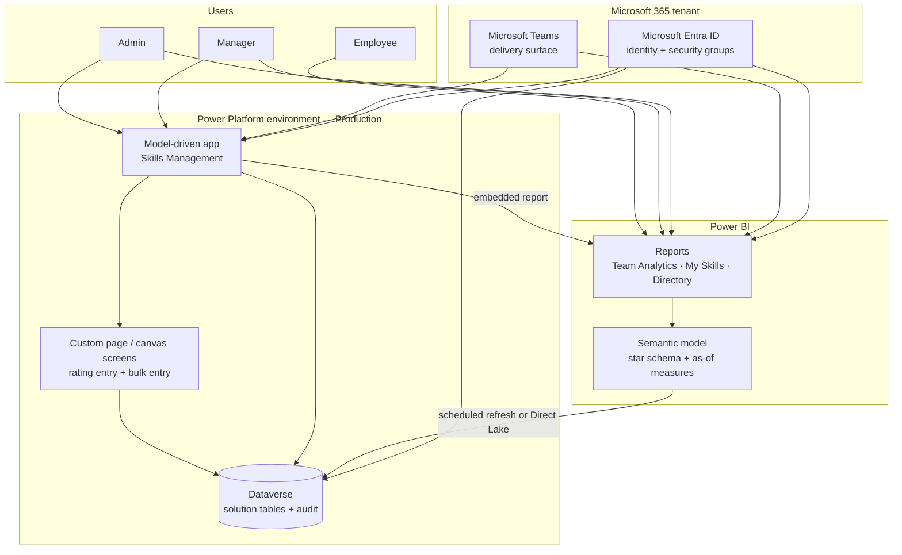
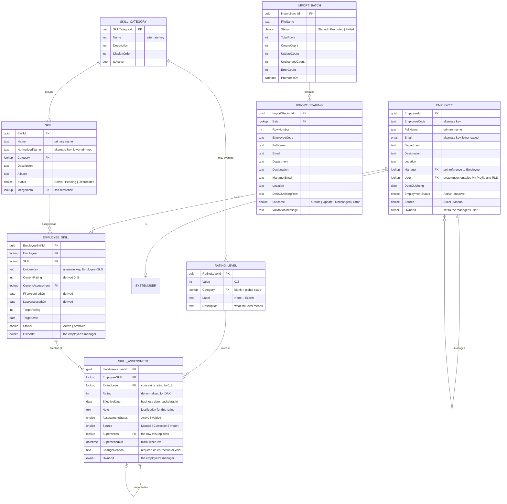
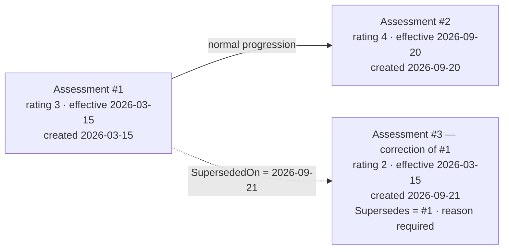
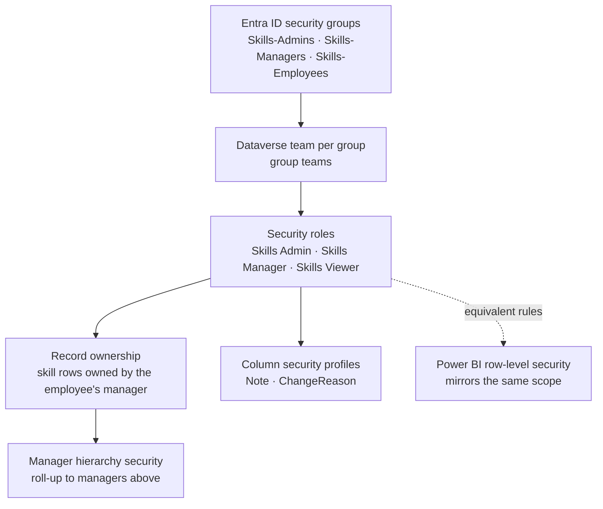
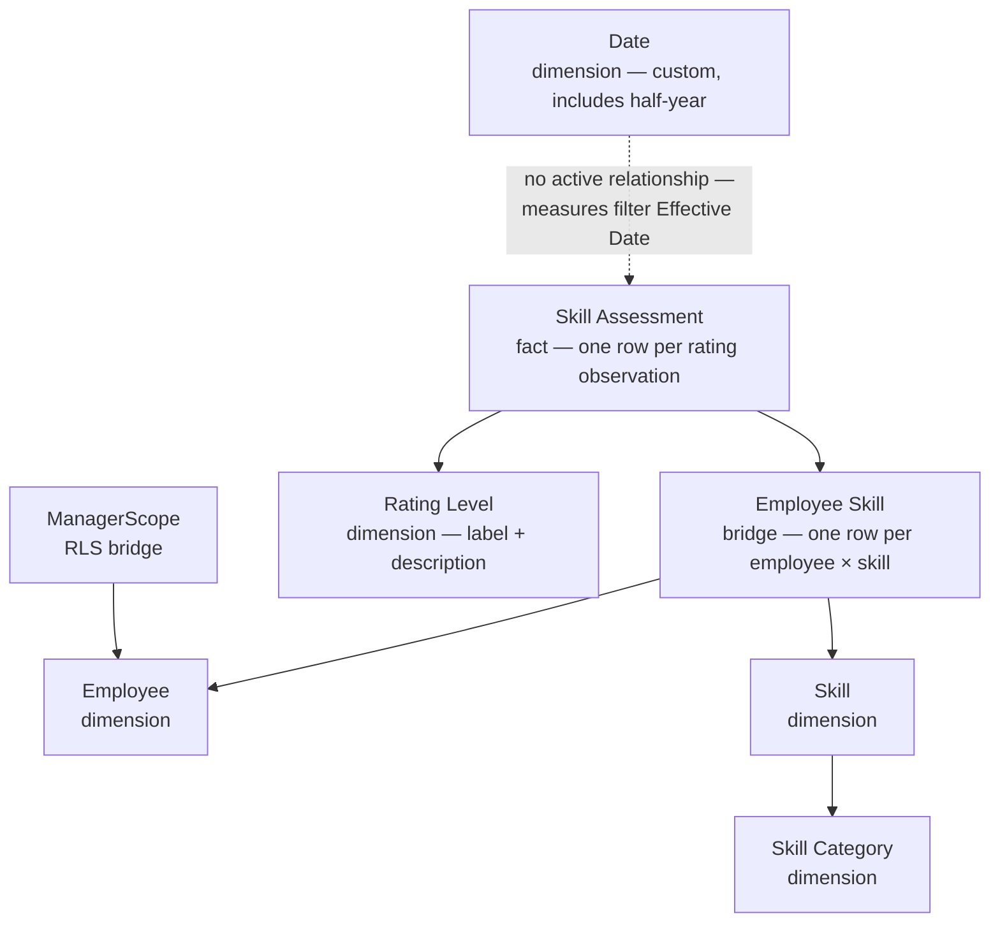
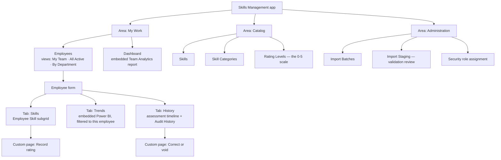
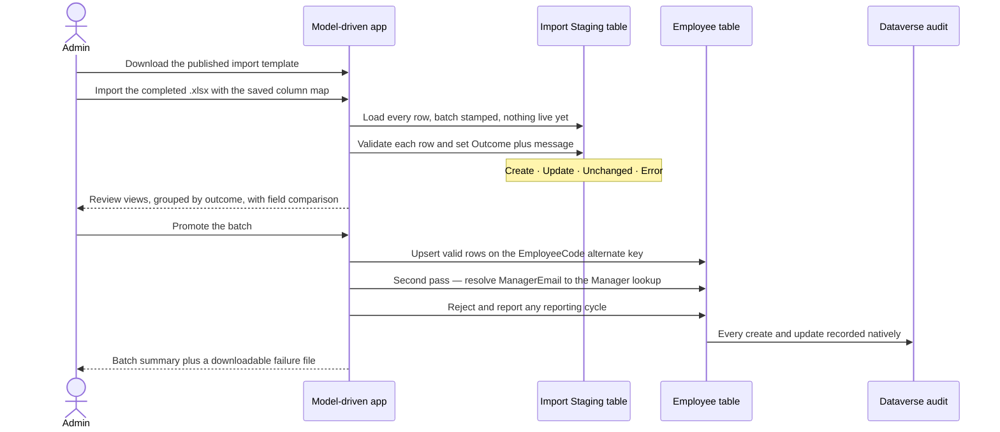
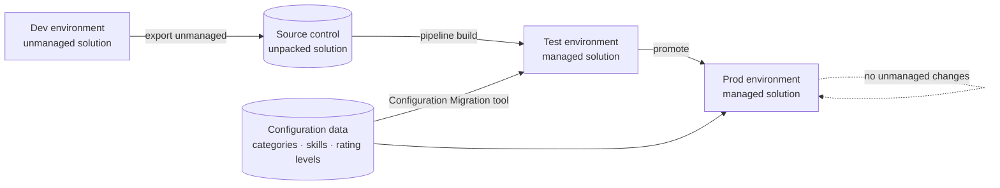

# Employee Skills & Competency Management Dashboard — Solution Architecture

**Status:** Draft v2.0 for review — **Microsoft Power Platform edition**
**Companion document:** [REQUIREMENTS.md](REQUIREMENTS.md)
Diagrams use **Mermaid** and render in GitHub, VS Code, and most Markdown viewers.

> **v2.0 change:** the solution is built with **Power BI, Power Apps and
> Dataverse only**. This replaces the v1.0 custom Next.js / PostgreSQL design.
> The domain model and the temporal reasoning survive the move almost intact;
> what changes completely is how each rule is *enforced* — configuration and
> platform security instead of application code.
>
> The v1.0 prototype remains in this folder, parked and untouched.

---

## 1. Architectural drivers

| Driver | Source | Consequence in this design |
|---|---|---|
| **Nothing is ever lost**, yet managers can still correct old records. | FR-HIS-*, FR-AUD-* | An append-only assessment timeline with supersede columns (§5), plus native Dataverse auditing (§6). The Delete privilege is removed from every role. |
| **Trends key off when a rating was *true*, not when it was typed.** | FR-TRD-08, FR-HIS-07 | `Effective Date` (business date, backdatable) is modelled separately from `Created On` (platform timestamp). Power BI uses only the former. |
| **Ratings are sparse and must carry forward.** | FR-TRD-09 | The semantic model uses an as-of DAX pattern over a custom date table, not a period-average (§7.3). |
| **Three roles with different reach, enforced everywhere.** | FR-SEC-05, AC-9 | Dataverse security roles, record ownership, Manager hierarchy security, and column security — so the rules hold through the app, Excel, and the API alike (§6). |
| **No custom code.** | PC-1 … PC-6 | Every rule lands as configuration. Where that is genuinely weaker than code, §12 says so rather than papering over it. |
| **Licensing is a design input, not an afterthought.** | NFR-15 | Employees are served by Power BI rather than Power Apps, which changes the component boundaries (§11). |

---

## 2. Solution context



Three moving parts and no servers. Dataverse is the system of record, the
model-driven app is where data is maintained, and Power BI is where it is
analysed. Identity, auditing, and backup come from the platform.

---

## 3. Component responsibilities

| Component | Responsibility | Deliberately *not* responsible for |
|---|---|---|
| **Dataverse** | Tables, relationships, alternate keys, choices, business rules, security roles, ownership, hierarchy security, column security, auditing, backups. | Trend calculation; presentation. |
| **Model-driven app** | Employee directory and record, skills subgrid, catalog and rating-scale administration, import review, per-record Audit History. | Enforcing permissions on its own; complex multi-row writes. |
| **Custom page (canvas)** | The single sanctioned write path for ratings: create an assessment and update the parent employee-skill in one user action. Bulk entry. | Holding any rule the security model should hold. |
| **Power BI semantic model** | The star schema, the custom date table, the as-of carry-forward measures, row-level security. | Storing data or accepting writes. |
| **Power BI reports** | Every trend, distribution, gap, and staleness visual; the employee-facing read-only experience. | Data entry. |
| **Entra ID** | Authentication, and group membership that drives role assignment. | Any application-specific permission logic. |

---

## 4. Dataverse data model

Logical names use the `skl_` publisher prefix. Names below are display names.



### 4.1 Keys, constraints, and how each rule is enforced

| Rule | Requirement | Mechanism |
|---|---|---|
| One row per employee per skill | NFR-06 | `UniqueKey` text column (`EmployeeCode|NormalizedSkillName`) configured as an **alternate key** on `Employee Skill`. |
| Ratings are 0–5 only | FR-RAT-01, AC-12 | `Rating` is set from a **lookup to `Rating Level`**, which holds exactly six rows. There is no free numeric entry, so the bound holds on every path including import. |
| Skill names unique, case-insensitively | FR-CAT-05, AC-11 | `NormalizedName` as an **alternate key**; the entry form populates it from `Name`. |
| Employee identity | FR-IMP-06 | `EmployeeCode` and `Email` both alternate keys, giving true upsert on import. |
| Effective date never in the future | FR-SKL-05 | **Business rule** on the form plus a validation column on the custom page. |
| Correction or void needs a reason ≥ 10 chars | FR-HIS-03, AC-4 | **Business rule**: when `Source = Correction` or `AssessmentStatus = Voided`, `ChangeReason` is required. |
| Assessments can never be deleted | FR-HIS-05, AC-13 | The **Delete privilege on `Skill Assessment` is set to None for every security role**, including Admin. |
| Nobody manages themselves | Data quality | Business rule on `Employee`; deeper reporting cycles are caught during import validation. |

### 4.2 Derived columns

`Employee Skill.CurrentRating`, `CurrentAssessment`, `FirstAcquiredOn`, and
`LastAssessedOn` are **stored**, not computed on read, because the directory and
the skills subgrid display them constantly and Dataverse cannot express
"the rating of the child row with the greatest effective date" as a rollup.

They are maintained by the **custom page**, which writes the assessment and
updates the parent in the same user action (§9.2). This is the most significant
consequence of excluding Power Automate — see §12.

---

## 5. The temporal model

This survives the platform change unaltered, because it is a modelling decision
rather than a technology one.

### 5.1 Two time axes

| Axis | Column | Meaning | Consumed by |
|---|---|---|---|
| **Business time** | `Effective Date` | The date from which the rating was true. Backdatable. | Every Power BI trend, the current rating, the first-acquired date. |
| **System time** | `Created On`, `Superseded On` | When the row was written, and when it stopped being current. Never backdatable. | The history view and Dataverse audit. |

Separating them is what lets a manager correct a March rating in September
without the audit trail losing the fact that the system believed something
different in between.

### 5.2 Corrections supersede; they never overwrite



After the correction three rows exist:

| # | Rating | Effective Date | Created On | Supersedes | Superseded On | Status | IsLive |
|---|---|---|---|---|---|---|---|
| 1 | 3 | 2026-03-15 | 2026-03-15 | — | 2026-09-21 | Active | No |
| 2 | 4 | 2026-09-20 | 2026-09-20 | — | — | Active | Yes |
| 3 | 2 | 2026-03-15 | 2026-09-21 | #1 | — | Active | Yes |

**Live** means `Superseded On` is blank *and* `AssessmentStatus` is Active. This
is deliberately **not** stored as a column in Dataverse — a stored flag is one
more thing that can drift out of step with the two columns it summarises. Instead
it is expressed once in each place it is needed: as a two-condition filter on
Dataverse views, and as a calculated column `IsLive` in the Power BI semantic
model (§7.3). Everything downstream keys off it:

- **Power BI trends and the current rating** filter `IsLive = true` — they see
  rows 3 and 2, the corrected timeline (AC-3).
- **The history view** filters nothing, so it shows all three and renders
  row 1 → row 3 as a `3 → 2` correction with its reason and both dates.

A **void** sets `AssessmentStatus = Voided` with a reason, which clears `IsLive`
by the same calculation. No row is ever removed.

### 5.3 Why this still matters on Dataverse

Dataverse auditing already records that a value changed. It does **not** give a
queryable, point-in-time timeline that Power BI can aggregate — audit data is not
a reportable table. So the supersede model provides the *analytical* history and
Dataverse auditing provides the *forensic* history. They serve different readers
and both are required.

---

## 6. Security architecture

Five platform mechanisms combine to deliver the permission matrix. None of them
live in app logic, which is what makes AC-9 hold through Excel and the API too.



### 6.1 Privilege matrix

Levels are Dataverse access levels: **None**, **User** (records I own),
**BU** (business unit), **Org** (organisation-wide).

| Table | Privilege | Skills Admin | Skills Manager | Skills Viewer |
|---|---|:--:|:--:|:--:|
| Employee | Read | Org | Org | Org |
| Employee | Create / Write | Org | None | None |
| Employee | Delete | None | None | None |
| Skill Category | Read | Org | Org | Org |
| Skill Category | Create / Write | Org | None | None |
| Skill | Read | Org | Org | Org |
| Skill | Create | Org | Org | None |
| Skill | Write | Org | User | None |
| Skill | Delete | None | None | None |
| Rating Level | Read | Org | Org | Org |
| Rating Level | Write | Org | None | None |
| Employee Skill | Read | Org | Org | Org |
| Employee Skill | Create / Write | Org | **User** | None |
| Employee Skill | Delete | None | None | None |
| Skill Assessment | Read | Org | Org | **None** |
| Skill Assessment | Create | Org | **User** | None |
| Skill Assessment | Write | Org | **User** | None |
| Skill Assessment | **Delete** | **None** | **None** | **None** |
| Import Batch / Staging | All | Org | None | None |

Three rows carry most of the design:

- **Employee Skill and Skill Assessment write at `User` level** means "records I
  own". Combined with ownership being set to the employee's manager, a manager
  can maintain exactly their own people.
- **Manager hierarchy security** then extends that upward automatically, so a
  director sees and maintains their indirect reports without any extra
  configuration. This is the platform feature that replaces v1.0's recursive
  reporting-line query.
- **Skill Assessment Read is None for Skills Viewer**, which is how employees are
  prevented from reading colleagues' rating history and notes. Their own history
  reaches them through Power BI, where row-level security can filter by row —
  something Dataverse column security cannot do (open question 2).

An Admin grants organisation-wide write by additionally assigning **Skills
Manager (Org-wide)**, identical except that Employee Skill and Skill Assessment
privileges are at Org level.

### 6.2 Column security

`Note` and `ChangeReason` are protected by a **column security profile** granted
to Skills Admin and Skills Manager only. Because column security is per-user and
not per-row, an employee cannot be granted sight of their own note without also
seeing everyone's. The v1 default is therefore that employees do not see free-text
notes; REQUIREMENTS.md open question 2 records the decision and the alternative.

### 6.3 Power BI row-level security

The semantic model mirrors the Dataverse scope, because Power BI enforces its own
security independently.

| Role | Filter | Applies to |
|---|---|---|
| `Self` | `Employee[Email] = USERPRINCIPALNAME()` | The **My Skills** report — an employee sees only their own detail. |
| `ManagerScope` | `ManagerScope[ManagerEmail] = USERPRINCIPALNAME()` | The **Team Analytics** report — a manager sees their whole reporting line. |
| `OrgWide` | none | Admins and org-wide managers. |

`ManagerScope` is a **bridge table** holding one row per (employee, ancestor
manager) pair — the expanded reporting tree. Power BI RLS filters on one column,
so the hierarchy has to be flattened; it is produced in Power Query by walking
`Employee[Manager]` upward. This is the Power BI equivalent of Dataverse
hierarchy security, and the two must be kept consistent.

---

## 7. Power BI semantic model

### 7.1 Star schema



The date table is deliberately **not** joined to `Effective Date` with an active
relationship. An active join would answer "which assessments happened in March",
whereas every requirement here asks "what was the rating as at the end of March".
The measures apply the date filter themselves (§7.3).

### 7.2 The date table

Power BI has no native half-year, so FR-TRD-06 requires a custom calendar.

```dax
Date =
VAR BaseCalendar = CALENDAR ( DATE ( 2020, 1, 1 ), DATE ( 2032, 12, 31 ) )
RETURN
ADDCOLUMNS (
    BaseCalendar,
    "Year",         YEAR ( [Date] ),
    "Month No",     MONTH ( [Date] ),
    "Month",        FORMAT ( [Date], "MMM yyyy" ),
    "Month End",    EOMONTH ( [Date], 0 ),
    "Quarter No",   QUARTER ( [Date] ),
    "Quarter",      "Q" & QUARTER ( [Date] ) & " " & YEAR ( [Date] ),
    "Quarter End",  EOMONTH ( [Date], 2 - MOD ( MONTH ( [Date] ) - 1, 3 ) ),
    "Half No",      IF ( MONTH ( [Date] ) <= 6, 1, 2 ),
    "Half",         "H" & IF ( MONTH ( [Date] ) <= 6, 1, 2 ) & " " & YEAR ( [Date] ),
    "Half End",     EOMONTH ( [Date], 5 - MOD ( MONTH ( [Date] ) - 1, 6 ) ),
    "Year End",     DATE ( YEAR ( [Date] ), 12, 31 )
)
```

Granularity switching (FR-TRD-06) uses a **field parameter** over
`Month`, `Quarter`, `Half`, `Year`, so one visual serves all four periods and the
user changes the axis with a slicer — no duplicated pages.

### 7.3 The as-of carry-forward measures

This is the analytical heart of the solution. A rating at period end is **the most
recent live assessment with an effective date on or before that period end** — not
an average of whatever happened inside the period (FR-TRD-09).

`IsLive` is a calculated column on the fact table, defined once here rather than
stored in Dataverse (§5.2):

```dax
IsLive =
ISBLANK ( 'Skill Assessment'[Superseded On] )
    && 'Skill Assessment'[Assessment Status] = "Active"
```

```dax
-- Rating for ONE employee-skill as at the end of the current period.
-- Returns BLANK when the skill had not been acquired yet, which is what keeps
-- pre-acquisition periods empty instead of zero.
Rating As Of =
VAR AsOf = MAX ( 'Date'[Date] )
VAR LiveOnOrBefore =
    CALCULATETABLE (
        'Skill Assessment',
        REMOVEFILTERS ( 'Date' ),
        'Skill Assessment'[Effective Date] <= AsOf,
        'Skill Assessment'[IsLive] = TRUE
    )
VAR LastEffective =
    MAXX ( LiveOnOrBefore, 'Skill Assessment'[Effective Date] )
RETURN
    MAXX (
        FILTER ( LiveOnOrBefore, 'Skill Assessment'[Effective Date] = LastEffective ),
        'Skill Assessment'[Rating]
    )
```

```dax
-- Employee-level trend (FR-TRD-01) and skill-level trend (FR-TRD-03) are the
-- same measure: what differs is the filter context the visual supplies.
Avg Rating As Of =
AVERAGEX (
    VALUES ( 'Employee Skill'[Employee Skill Id] ),
    [Rating As Of]
)

-- Skills actually held at that point in time, so the count does not include
-- skills acquired later (FR-TRD-01).
Skills Held As Of =
COUNTROWS (
    FILTER (
        VALUES ( 'Employee Skill'[Employee Skill Id] ),
        NOT ISBLANK ( [Rating As Of] )
    )
)

-- People holding this skill at that point (FR-TRD-03).
Employees Holding As Of =
CALCULATE (
    DISTINCTCOUNT ( 'Employee Skill'[Employee] ),
    FILTER (
        VALUES ( 'Employee Skill'[Employee Skill Id] ),
        NOT ISBLANK ( [Rating As Of] )
    )
)

-- Change versus the previous visible period (FR-TRD-11).
Avg Rating Delta =
VAR CurrentValue = [Avg Rating As Of]
VAR PreviousValue =
    CALCULATE (
        [Avg Rating As Of],
        PREVIOUSMONTH ( 'Date'[Date] )   -- swapped per granularity, or via a calculation group
    )
RETURN
    IF ( NOT ISBLANK ( CurrentValue ) && NOT ISBLANK ( PreviousValue ), CurrentValue - PreviousValue )
```

Three properties map straight onto requirements:

- `Effective Date <= AsOf` gives carry-forward for free: a skill rated once in
  2025 still reports that rating in every later period (AC-6).
- A skill with no assessment on or before the period returns BLANK, and
  `AVERAGEX` ignores blanks — so pre-acquisition periods are **absent, not zero**.
- `IsLive = TRUE` means a correction made today retroactively reshapes the whole
  chart, which is the intended behaviour (AC-3, FR-TRD-10).

`Rating As Of` is an iterator inside an iterator, which is the expensive pattern
in DAX. For the volumes in NFR-01 it is acceptable on an import model. If it
becomes slow, the mitigation is a **pre-computed monthly snapshot** built in
Power Query or a Dataverse view — one row per employee-skill per month — after
which the measure becomes a simple average. That is an additive change.

### 7.4 Report pages

| Report | Audience | Pages |
|---|---|---|
| **Team Analytics** | Managers, Admins | Overview KPIs · Employee trend · Employee × skill detail · Skill trend · Category comparison · Coverage matrix · Gaps and staleness · Recent changes |
| **My Skills** | All employees | My profile · My progression · My category radar |
| **Skills Directory** | All employees | Who has which skill, current ratings only, no notes or history |

Team Analytics is **embedded into the model-driven app** (FR-TRD-16) so managers
analyse and act without switching tools, and is also published to a workspace app
and pinned in Teams.

---

## 8. Data refresh: the central trade-off

Data entry is immediate in Dataverse, but Power BI sees it only when the model
refreshes. NFR-03 requires trends no more than one hour stale.

| Option | Freshness | Report speed | Cost / prerequisite | Verdict |
|---|---|---|---|---|
| **Dataverse connector, Import mode, scheduled refresh** | 8 refreshes/day on Pro; 48/day on PPU | Fast | Power BI Pro or PPU | **Recommended start.** 48/day on PPU is every 30 minutes and meets NFR-03. Pro alone does not. |
| **Dataverse connector, DirectQuery** | Live | Noticeably slower, and the as-of measures are iterator-heavy | Pro | Not recommended — this measure pattern is exactly what DirectQuery handles worst. |
| **Link to Microsoft Fabric + Direct Lake** | Near-live | Fast | Fabric capacity (F64+ for free viewers) | **Recommended target** if a capacity exists or is planned — it also solves the employee licensing question in §11. |
| **Azure Synapse Link** | Near-live | Fast | Azure subscription | Adds an Azure dependency outside the stated constraint. |

The architecture is written so this choice can change later without touching the
data model, the app, or the measures — only the model's storage mode changes.

---

## 9. Power Apps design

### 9.1 Model-driven app structure



### 9.2 The rating-entry custom page

The one place ratings are written. It exists because a single user action has to
touch two rows, and without Power Automate the app has to do it.

| Control | Behaviour | Requirement |
|---|---|---|
| Skill selector | Combo box over active `Skill`, type-ahead, grouped by category, excluding skills the employee already holds. | FR-SKL-02 |
| "＋ New skill" | Inline form creating a catalog row, then selecting it. | FR-SKL-04, FR-CAT-04 |
| Rating selector | Dropdown bound to `Rating Level`, displaying `Value — Label`, with `Description` shown beneath the field. Because it is data-bound, an Admin's wording change appears immediately. | FR-SKL-03, FR-RAT-02/04 |
| Effective date | Date picker defaulting to today, `MaxDate = Today()`. | FR-SKL-05 |
| Note | Multiline text. | FR-RAT-06 |
| Save | Patches in sequence: supersede any same-day live assessment → create the new assessment → update the parent `Employee Skill` derived columns. | FR-SKL-06/07/08/09 |

```
// Save, in outline
If( !IsBlank(SameDayLive),
    Patch( 'Skill Assessments', SameDayLive, { SupersededOn: Now() } ) );

Set( gNew,
     Patch( 'Skill Assessments', Defaults('Skill Assessments'),
            { EmployeeSkill: gEmployeeSkill,
              RatingLevel:   cboRating.Selected,
              Rating:        cboRating.Selected.Value,
              EffectiveDate: dteEffective.SelectedDate,
              Note:          txtNote.Text,
              Source:        'Source (Skill Assessments)'.Manual } ) );

Patch( 'Employee Skills', gEmployeeSkill,
       { CurrentRating:     gNew.Rating,
         CurrentAssessment: gNew,
         LastAssessedOn:    Max( LiveTimeline, EffectiveDate ),
         FirstAcquiredOn:   Min( LiveTimeline, EffectiveDate ) } );
```

The correction page is the same shape, additionally setting `Supersedes`,
`Source = Correction`, and a mandatory `ChangeReason`, then recomputing the parent
from the corrected timeline (FR-HIS-06).

### 9.3 Business rules

| Rule | Table | Effect |
|---|---|---|
| Reason required on correction or void | Skill Assessment | `ChangeReason` becomes required when `Source = Correction` or `AssessmentStatus = Voided` (FR-HIS-03). |
| No future effective date | Skill Assessment | Validation error when `Effective Date > Today` (FR-SKL-05). |
| Target date needs a target rating | Employee Skill | `Target Date` requires `Target Rating` (FR-SKL-11). |
| Manager cannot be self | Employee | Validation error when `Manager = this record`. |
| Deprecated skills not selectable | Employee Skill | Lookup view filtered to `Status = Active` (FR-CAT-07). |

---

## 10. Excel import pipeline



Validation rules applied in staging (FR-IMP-07): required columns present;
`employee_code` unique within the file; `email` well-formed and unique;
`manager_email` resolvable; `date_of_joining` parseable; `employment_status` a
known value. Manager resolution is a deliberate **second pass** so a manager
listed further down the file still links (FR-IMP-10).

Nothing in this path reads or writes skills or assessments, so an import can
never disturb rating history (FR-IMP-06).

---

## 11. Licensing and capacity

| Audience | Volume | Needs | Licence |
|---|---|---|---|
| Admin | 2–3 | Full app, imports, reports | Power Apps Premium + Power BI Pro |
| Manager | ~50 | App write, reports | Power Apps Premium + Power BI Pro |
| Employee | ~2,000 | Read-only profile and directory | **Power BI only** — Pro each, or free viewers on a Fabric F64+ capacity |

Serving employees through **Power BI rather than Power Apps** is the single
largest cost decision, and it is why the component boundaries in §3 put the
employee experience in reports rather than in the app.

**Capacity:** Dataverse storage for NFR-01 volumes is modest. The item to watch is
**audit log capacity** — auditing every column on `Skill Assessment` grows
steadily. Set retention deliberately (FR-AUD-09) and review consumption in the
admin centre quarterly.

---

## 12. Where the constraint costs us

An honest account of what excluding Power Automate and pro-code (PC-5, PC-6)
gives up, so the trade-off is a decision rather than a surprise.

| Behaviour | With a flow or plugin | As designed here | Residual risk |
|---|---|---|---|
| Stamping `SupersededOn` and recomputing the parent's derived columns | A synchronous flow or plugin guarantees it on every write path, including the API. | The custom page does it (§9.2). | **Medium.** A user with Write on `Skill Assessment` could write directly through the API or Excel and skip the parent update, leaving `CurrentRating` stale. Mitigated by funnelling entry through the page, by auditing, and by a Power BI reconciliation page that lists rows where `CurrentRating` disagrees with the live timeline. |
| Enforcing "reason ≥ 10 characters" | Server-side, unconditional. | Business rule plus form validation — client-side. | **Low.** The reason column is still audited, so a missing reason is visible. |
| Resolving the manager hierarchy after import | A flow loops the staged rows automatically. | A second import pass mapping `ManagerEmail`, run by the Admin. | **Low.** One extra deliberate step. |
| Notifying an employee when their rating changes | Trivial with a flow. | Not available. | Out of scope for v1 anyway. |
| Preventing deletion | Not needed — already covered. | Delete privilege removed for every role. | **None.** This one is actually *stronger* than the custom-code design, because it holds at the platform level. |

**Recommendation:** permit **one synchronous Power Automate flow** on
`Skill Assessment` create and update. It removes the only medium risk in this
table and makes the derived columns trustworthy on every path. This is
REQUIREMENTS.md open question 1.

---

## 13. Application lifecycle management



- One **publisher** and one **solution**, containing the tables, app, roles,
  business rules, and column security profiles.
- **Environment variables** for the tunable thresholds (staleness months, gap
  threshold, correction warning window) so each environment differs by
  configuration, not by customisation.
- **Connection references** for the Power BI embedding so promotion does not
  require re-pointing by hand.
- **Configuration data** — the seeded categories, skills, and the six rating
  levels — deployed with the Configuration Migration tool so every environment
  starts identical (FR-CAT-03).
- Power BI content is deployed through a **Power BI deployment pipeline** with
  parameterised data source settings.

---

## 14. Testing and acceptance

| Level | Approach | Focus |
|---|---|---|
| Configuration review | Solution checker plus peer review | Alternate keys, business rules, and — critically — the privilege matrix in §6.1. |
| Security testing | Sign in as a seeded user per role | The whole of AC-9, AC-10, and AC-13, tested through the app, an Excel export round-trip, and a direct API call. |
| Data-model testing | Seeded scenarios in the Test environment | The correction and void lifecycle: supersede chains, recomputed current rating, recomputed first-acquired date. |
| Measure testing | Hand-computed expected series | The as-of carry-forward measures at all four granularities, including the half-year boundary and the current partial period. This carries the highest defect cost, because a wrong chart still looks like a plausible chart. |
| Import testing | A file deliberately seeded with every error class | Per-row rejection, the second-pass manager resolution, and cycle detection. |
| UAT | Two managers and one admin, on real data | Three clicks to record a rating (NFR-08); trends that match their own expectation of their team. |

---

## 15. Decision record

| # | Decision | Alternatives considered | Rationale |
|---|---|---|---|
| AD-1 | Business time separate from system time | A single date column | Without it, correcting a March rating in September either falsifies the audit trail or corrupts the trend. Both are explicit requirements. |
| AD-2 | Corrections supersede rather than overwrite | Overwrite and rely on Dataverse audit | Dataverse audit is not a reportable table. The supersede chain is what Power BI can aggregate into a corrected timeline. |
| AD-3 | Keep the supersede model **and** enable Dataverse auditing | Either one alone | They answer different questions: analytical history versus forensic history. |
| AD-4 | `Rating` is a lookup to a six-row `Rating Level` table | A choice column, or a whole-number column with a business rule | Makes 0–5 unbreakable on every path including import, and makes the level descriptions editable as data without a deployment (FR-RAT-04). |
| AD-5 | Derived `CurrentRating` stored on `Employee Skill` | Compute on read | Dataverse rollups cannot express "value of the child row with the greatest date", and the directory reads it constantly. Accepted with the reconciliation control in §12. |
| AD-6 | Manager scope via **hierarchy security and ownership** | Business-unit partitioning, or filtered views | Hierarchy security is a native feature that exactly matches "direct and indirect reports", and it applies to the API and Excel as well as the app. |
| AD-7 | Employees served by **Power BI, not Power Apps** | Licensing every employee for Power Apps | Removes the dominant licensing cost for read-only users and is the only place row-level "my own record" filtering is expressible. |
| AD-8 | As-of carry-forward measures rather than period averages | Averaging assessments inside each bucket | Ratings are sparse. Bucket averaging would show gaps wherever a skill is simply stable, which inverts the meaning. |
| AD-9 | Custom date table with an explicit half-year column | Power BI's built-in date hierarchy | There is no native half-year, and FR-TRD-06 requires one. |
| AD-10 | Model-driven app as the shell, canvas custom pages for entry | All canvas, or all model-driven | Model-driven gives views, security trimming, and the Audit History tab for free; canvas gives the multi-row write and the fast entry form. Each is used where it is strong. |
| AD-11 | Import through a staging table | Importing straight into `Employee` | FR-IMP-04 requires review before anything is written, and the native import wizard alone cannot preview a field-level diff. |
| AD-12 | No Delete privilege for anyone on assessments | Soft-delete flag | "Keep all history" becomes a platform guarantee rather than a convention, and it is stronger than what the v1.0 custom design offered. |

---

## 16. Future extensions

Each fits the model without a redesign.

- **Self-assessment with manager approval** — add a `Proposed By` column and an
  approval status; the supersede model already treats approval as a new version.
- **One synchronous flow** on `Skill Assessment` to guarantee derived columns
  (§12) — the highest-value single addition if PC-6 is relaxed.
- **Monthly snapshot table** for measure performance at larger volumes (§7.3).
- **HRIS synchronisation** replacing the Excel import — the staging table and its
  validation rules stay; only the loader changes.
- **Required-skills profiles per role** — a `Role Skill Requirement` table turns
  the existing gap page into per-role gap analysis.
- **Certifications and evidence** — a child table on `Skill Assessment`, with file
  attachments held in Dataverse or SharePoint.
- **Teams delivery** — surface My Skills as a Teams tab and let managers record a
  rating from an adaptive card.
