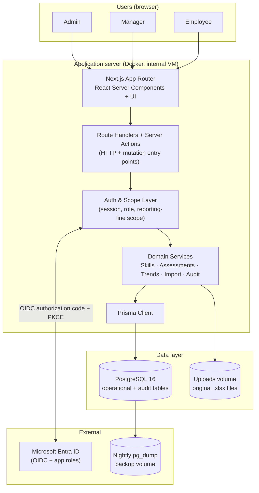
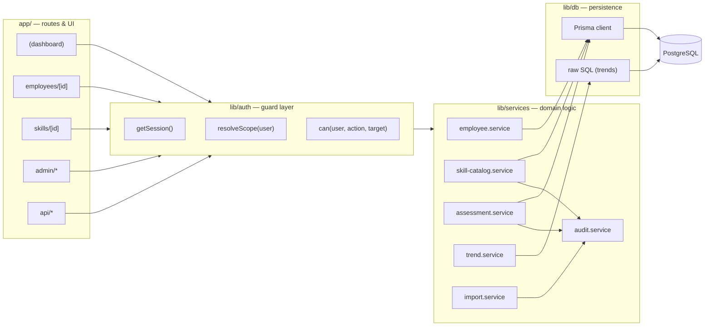
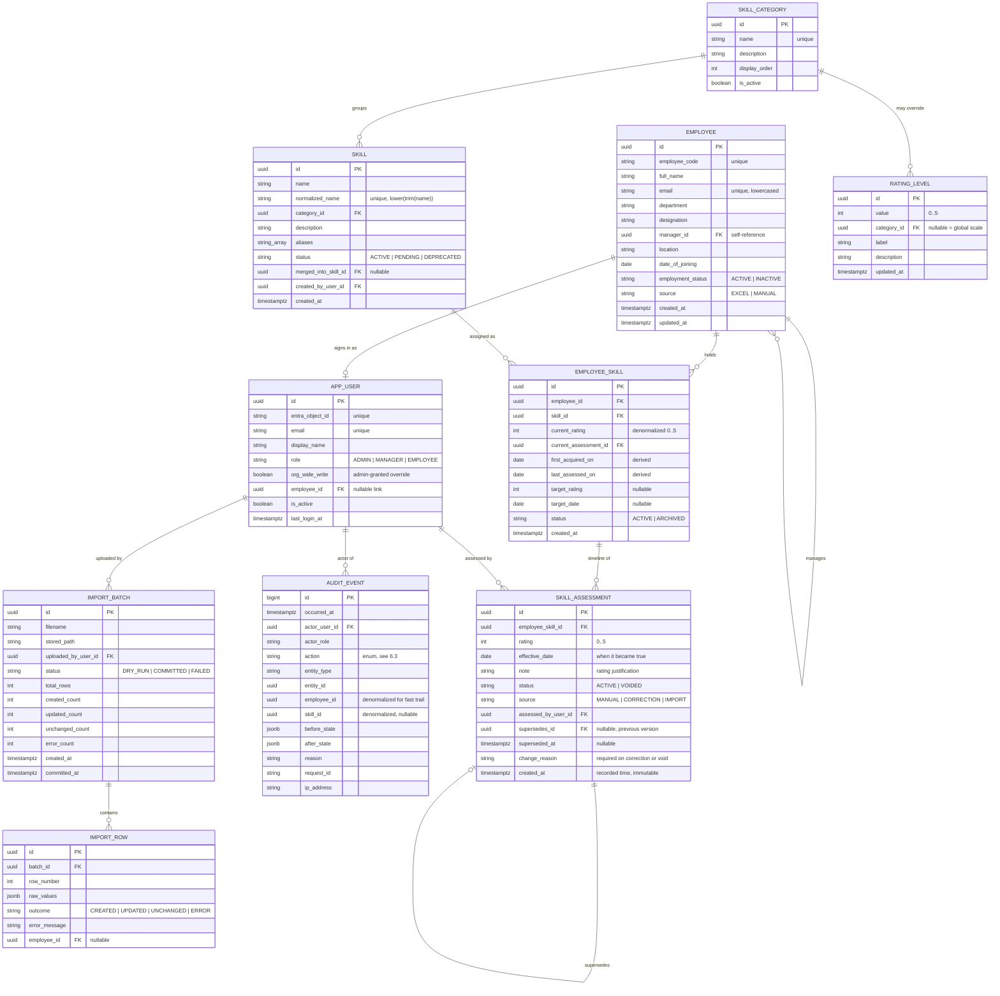
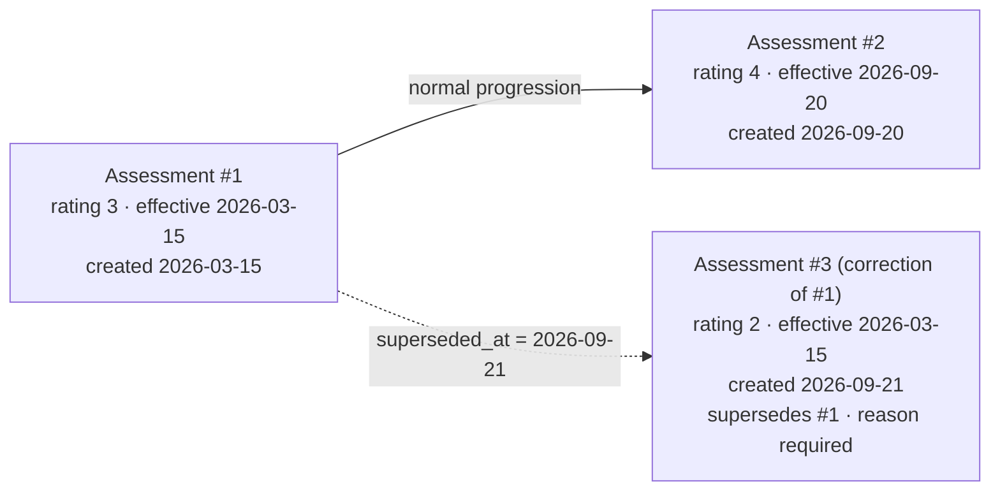
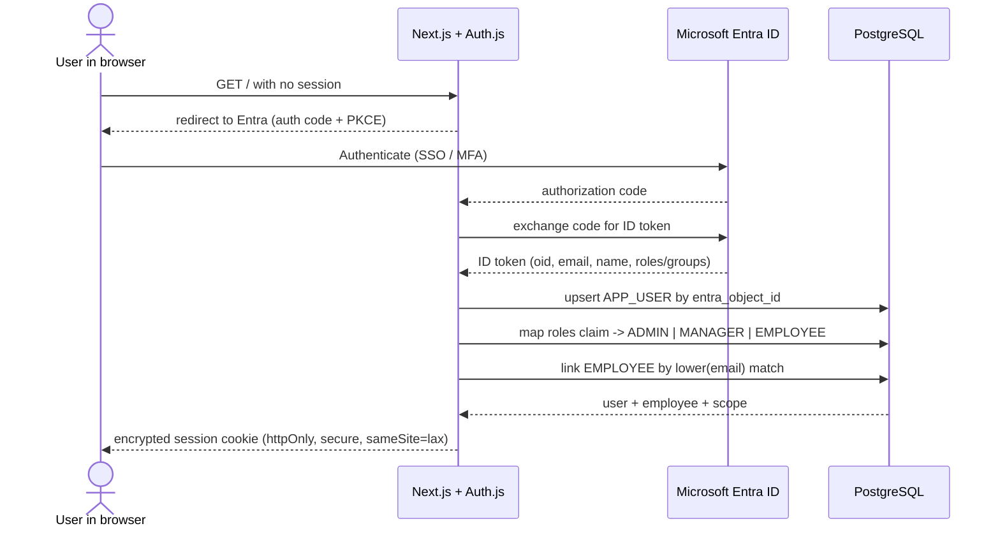
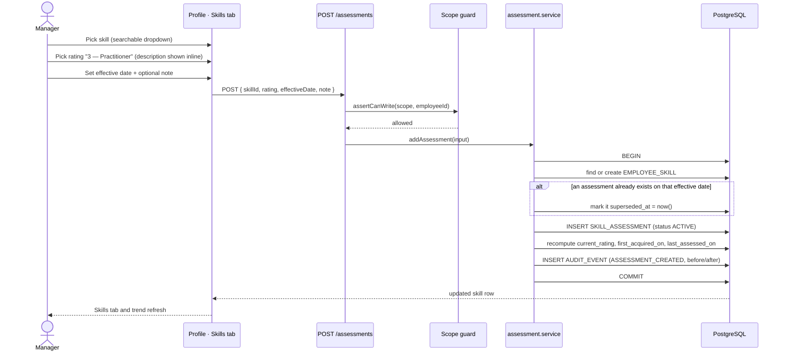
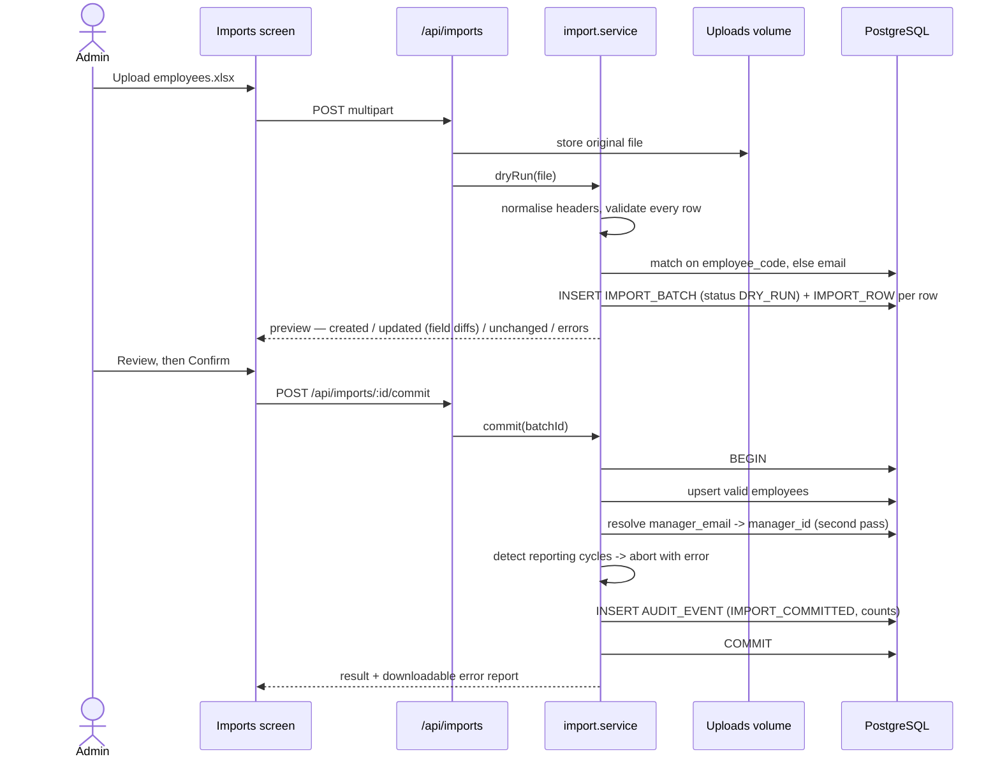
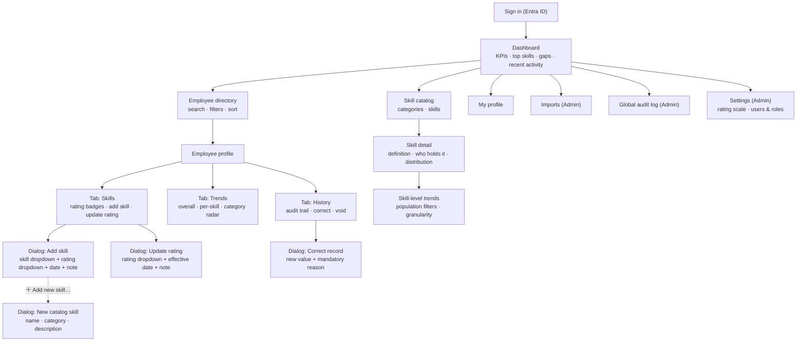
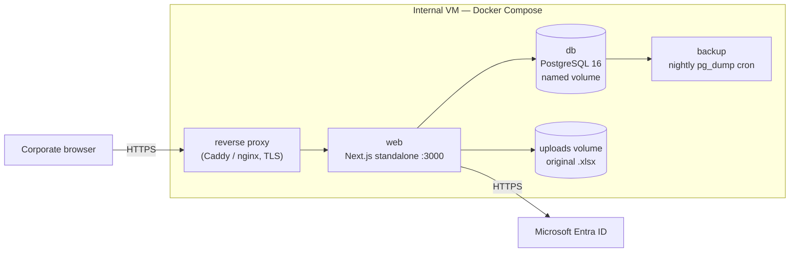

# Employee Skills & Competency Management Dashboard — System Architecture

**Status:** Draft v1.0 for review
**Companion document:** [REQUIREMENTS.md](REQUIREMENTS.md)
Diagrams use **Mermaid** and render in GitHub, VS Code, and most Markdown viewers.

---

## 1. Architectural drivers

Four requirements shape every significant decision in this design.

| Driver | Source | Consequence |
|---|---|---|
| **Nothing is ever lost.** Every rating change must be reconstructable, and managers can still correct old records. | FR-HIS-*, FR-AUD-* | A bi-temporal data model plus a separate append-only audit log (§5, §6). |
| **Trends are driven by when a rating was *true*, not when it was typed in.** | FR-TRD-08, FR-HIS-07 | Effective date and recorded time are distinct columns; all analytics key off effective date (§7). |
| **Ratings are sparse and must carry forward.** People are not reassessed every month. | FR-TRD-09 | Trends use an as-of / last-value-carried-forward query, not a per-bucket average of new entries (§7.2). |
| **Three roles with different read and write reach.** | FR-SEC-05 | Authorisation is a server-side scope resolver applied in a service layer that the UI cannot bypass (§8). |

---

## 2. System context



A single deployable unit. Next.js serves both the UI and the HTTP API, and talks
to one PostgreSQL instance. The only external dependency at runtime is Entra ID
for sign-in.

---

## 3. Technology stack

| Layer | Choice | Why |
|---|---|---|
| Framework | **Next.js 15 (App Router) + React 19 + TypeScript (strict)** | One codebase and one deployable for UI and API. Server Components keep heavy directory and trend queries on the server, which matters for the tables and charts this app is built around. |
| UI | **Tailwind CSS + shadcn/ui (Radix primitives)** | Radix gives accessible combobox, dialog, and select components out of the box — directly serving the searchable skill dropdown (FR-SKL-02) and WCAG 2.1 AA (NFR-09). |
| Charts | **Recharts** | Composable React charts covering line, step-line, stacked bar, and radar. Every chart pairs with a data-table toggle for accessibility. |
| Validation | **Zod** | One schema validates the HTTP body, the server action input, and the form, so rating bounds (FR-RAT-01) cannot be bypassed on any path. |
| ORM | **Prisma 6** | Typed client, first-class migrations. Raw SQL via `$queryRaw` is used for the trend engine, which needs window functions Prisma's query API does not express. |
| Database | **PostgreSQL 16** | `DISTINCT ON`, `generate_series`, partial indexes, and `jsonb` are all load-bearing in §6 and §7. |
| Auth | **Auth.js v5 (NextAuth) + Microsoft Entra ID provider** | Standard OIDC authorization-code + PKCE flow, encrypted session cookie, no password storage. |
| Excel | **ExcelJS** | Streaming `.xlsx` parsing with no known parser-security history; handles the 10,000-row ceiling comfortably. |
| Logging | **Pino** | Structured JSON logs with a per-request correlation ID. |
| Testing | **Vitest** (unit/integration) + **Playwright** (end-to-end) | Trend maths and the correction model need table-driven unit tests; the multi-role permission matrix needs real browser runs. |
| Packaging | **Docker Compose** | Matches the internal-VM deployment target. |

### 3.1 Note on the development database

The original intent was SQLite locally and PostgreSQL in production. Prisma pins
the provider in `schema.prisma`, so supporting both means two schema files that
drift, and the trend engine's `DISTINCT ON` and `generate_series` have no SQLite
equivalent — the query most worth testing would be the one least covered locally.
Development therefore runs **PostgreSQL in Docker**, which the deployment already
requires. `docker compose up db` is the only prerequisite for a local run.

---

## 4. Application structure



Three rules hold the structure together:

1. **No route touches Prisma directly.** Routes resolve a session, then call a
   service. This is what makes FR-SEC-05 enforceable in one place.
2. **Every mutating service writes its audit event inside the same database
   transaction as the change.** An audited change and its audit record commit or
   fail together — there is no window where one exists without the other.
3. **The trend service is read-only** and is the only component permitted to use
   raw SQL.

---

## 5. Data model



### 5.1 Constraints and indexes

| Table | Constraint / index | Purpose |
|---|---|---|
| `employee` | unique `employee_code`; unique `lower(email)`; index on `manager_id` | Import upsert keys (FR-IMP-06) and reporting-line traversal. |
| `employee` | check: `manager_id <> id` | Blocks self-management; cycles are caught in the import service (FR-IMP-10). |
| `skill` | unique `normalized_name` | Case-insensitive uniqueness (FR-CAT-05). |
| `rating_level` | unique `(category_id, value)`; check `value BETWEEN 0 AND 5` | Global scale plus optional per-category overrides (FR-RAT-05). |
| `employee_skill` | unique `(employee_id, skill_id)` | One row per employee per skill (NFR-05). |
| `employee_skill` | check `current_rating BETWEEN 0 AND 5` | Database-level rating bounds (AC-12). |
| `skill_assessment` | check `rating BETWEEN 0 AND 5`; check `effective_date <= CURRENT_DATE` | No out-of-range or future-dated ratings (NFR-05). |
| `skill_assessment` | index `(employee_skill_id, effective_date DESC, created_at DESC)` | The access path for every as-of and timeline query. |
| `skill_assessment` | partial index on `(employee_skill_id, effective_date DESC) WHERE superseded_at IS NULL AND status = 'ACTIVE'` | Keeps the trend engine scanning only live rows. |
| `audit_event` | indexes on `(employee_id, occurred_at DESC)`, `(entity_type, entity_id, occurred_at DESC)`, `(actor_user_id, occurred_at DESC)` | The three ways the audit trail is read (FR-AUD-04, FR-AUD-07). |
| `audit_event` | database grants: `INSERT` and `SELECT` only for the application role | Makes append-only a property of the database, not a convention (FR-AUD-03). |

### 5.2 Why `current_rating` is denormalized

The directory lists hundreds of employees with their average rating, and the
profile lists every skill with its current level. Deriving those from the
assessment timeline on every page load would mean a correlated latest-row lookup
per employee-skill. `employee_skill.current_rating` and `current_assessment_id`
are therefore maintained by `assessment.service` inside the same transaction as
any assessment write, correction, or void. The timeline stays the source of
truth; the denormalized columns are a cache that is always rebuilt from it, and a
consistency check job can verify them.

---

## 6. The temporal and audit model

This is the heart of the design. Two independent mechanisms serve two different
questions.

### 6.1 Two time axes

| Axis | Column | Meaning | Who uses it |
|---|---|---|---|
| **Valid time** | `skill_assessment.effective_date` | The date from which the rating was true. Backdatable. | Trends, current rating, first-acquired date. |
| **Transaction time** | `skill_assessment.created_at` + `superseded_at` | When the row was written and when it stopped being the current version. Never backdatable. | Audit trail, "what did we believe on date X". |

Keeping these apart is what allows a manager to correct a March rating in
September (FR-HIS-01) while the audit trail still shows that the system believed
something different between March and September (NFR-04).

### 6.2 Corrections supersede; they never overwrite

An assessment row is immutable once written. Every change produces a new row.



After the correction the table holds three rows:

| id | rating | effective_date | created_at | supersedes | superseded_at | status |
|---|---|---|---|---|---|---|
| #1 | 3 | 2026-03-15 | 2026-03-15 | — | 2026-09-21 | ACTIVE |
| #2 | 4 | 2026-09-20 | 2026-09-20 | — | — | ACTIVE |
| #3 | 2 | 2026-03-15 | 2026-09-21 | #1 | — | ACTIVE |

Two different reads over the same rows:

- **Trends and current state** filter `superseded_at IS NULL AND status = 'ACTIVE'`,
  so they see #3 and #2 — the corrected timeline, exactly as AC-3 requires.
- **The history tab** filters nothing, so it shows all three and can render #1 → #3
  as a `3 → 2` correction with its reason and both timestamps.

A **void** (FR-HIS-04) sets `status = 'VOIDED'` with a reason. Voided rows are
excluded from the first filter and included in the second, and are never deleted.

After any write, correction, or void, `assessment.service` recomputes
`current_rating`, `current_assessment_id`, `first_acquired_on`, and
`last_assessed_on` for that employee skill from the live timeline (FR-HIS-06).

### 6.3 The audit log

The superseding model above records the history of *ratings*. The `audit_event`
table records the history of *everything*, including changes the assessment table
cannot express — catalog edits, rating-scale text changes, role grants, imports.

Actions recorded: `EMPLOYEE_CREATED`, `EMPLOYEE_UPDATED`, `SKILL_ASSIGNED`,
`SKILL_ARCHIVED`, `ASSESSMENT_CREATED`, `ASSESSMENT_CORRECTED`,
`ASSESSMENT_VOIDED`, `CATALOG_SKILL_CREATED`, `CATALOG_SKILL_UPDATED`,
`CATALOG_SKILL_DEPRECATED`, `CATALOG_SKILL_MERGED`, `CATEGORY_CHANGED`,
`RATING_SCALE_CHANGED`, `ROLE_CHANGED`, `IMPORT_COMMITTED`.

Each row carries `before_state` and `after_state` as `jsonb`, so the UI renders a
field-level diff without the service needing to know each entity's shape, and so
the state of any record at any past moment can be reconstructed by replaying
events (NFR-04).

Writes go through a single helper used by every service:

```ts
// lib/services/audit.service.ts — called inside the caller's transaction
await recordAudit(tx, {
  actor, action: 'ASSESSMENT_CORRECTED',
  entityType: 'SkillAssessment', entityId: original.id,
  employeeId, skillId,
  before: { rating: 3, effectiveDate: '2026-03-15' },
  after:  { rating: 2, effectiveDate: '2026-03-15' },
  reason: input.reason,
});
```

---

## 7. The trend engine

### 7.1 Period buckets

A trend request carries a granularity (`MONTH | QUARTER | HALF_YEAR | YEAR`), a
window, and a subject (one employee, one skill, or one category). The engine
turns the window into a list of **period end dates** and evaluates state at each.

Buckets come from `generate_series`. `date_trunc` handles `month`, `quarter`, and
`year` natively; **half-year has no `date_trunc` equivalent** and is computed
explicitly:

```sql
make_date(EXTRACT(YEAR FROM d)::int,
          CASE WHEN EXTRACT(MONTH FROM d) <= 6 THEN 1 ELSE 7 END,
          1)
```

Each bucket is anchored at its **last day**, and the current in-progress period is
anchored at `CURRENT_DATE` so the newest point reflects today rather than a future
date (AC-7).

### 7.2 The as-of rule (carry-forward)

The central analytical rule: **a rating at period end is the most recent live
assessment with an effective date on or before that period end.** It is not an
average of assessments that fall inside the bucket — ratings are sparse, and most
buckets contain no new assessment at all (FR-TRD-09).

```sql
WITH bucket AS (
  SELECT period_end FROM generate_period_ends($from, $to, $granularity)
),
as_of AS (
  SELECT DISTINCT ON (b.period_end, a.employee_skill_id)
         b.period_end,
         a.employee_skill_id,
         a.rating
  FROM   bucket b
  JOIN   employee_skill    es ON es.employee_id = $employeeId
                             AND es.status = 'ACTIVE'
  JOIN   skill_assessment  a  ON a.employee_skill_id = es.id
                             AND a.effective_date   <= b.period_end
  WHERE  a.superseded_at IS NULL
    AND  a.status = 'ACTIVE'
  ORDER  BY b.period_end, a.employee_skill_id,
            a.effective_date DESC, a.created_at DESC
)
SELECT period_end,
       ROUND(AVG(rating)::numeric, 2) AS avg_rating,
       COUNT(*)                       AS skills_held
FROM   as_of
GROUP  BY period_end
ORDER  BY period_end;
```

Three properties of this query map directly to requirements:

- `a.effective_date <= b.period_end` gives carry-forward for free — a skill rated
  once in 2025 still reports that rating in every later bucket (AC-6).
- A skill with no assessment on or before a bucket simply produces no row, so
  periods before acquisition are **absent rather than zero** (FR-TRD-09).
- `superseded_at IS NULL AND status = 'ACTIVE'` means a correction made today
  retroactively reshapes the whole chart, which is the intended behaviour (AC-3,
  FR-TRD-10).

### 7.3 Trend variants

| Variant | Requirement | Difference from the query above |
|---|---|---|
| Employee overall | FR-TRD-01 | As written: average across the employee's active skills. |
| Employee × skill | FR-TRD-02 | Drop the aggregate; return one series per selected skill. Rendered as a **step** line, matching carry-forward semantics. |
| Skill across a population | FR-TRD-03/04 | Filter `es.skill_id = $skillId`, join `employee` for department/manager/designation filters, and aggregate over employees. Also returns `employee_count`. |
| Category | FR-TRD-05 | Join `skill` and filter by `category_id`; group by `(period_end, category_id)`. |
| Distribution | FR-TRD-12 | Replace `AVG` with `COUNT(*) … GROUP BY period_end, rating` for stacked bars. |

Every response includes the delta against the previous bucket (FR-TRD-11) and the
raw series, so the chart-to-table toggle and CSV export (FR-TRD-15) need no second
request.

### 7.4 Performance

At the NFR-01 target — 2,000 employees, 500,000 assessments — the bucket join is
bounded by the partial index in §5.1 and returns comfortably within the 1 s p95
budget (NFR-02) for a single employee or a single skill.

Two escalation paths exist if org-wide, all-time, monthly charts become slow:

1. **Response caching** keyed on `(subject, granularity, window, filters, maxAuditId)`.
   The key includes the latest audit event ID so any write invalidates it naturally.
2. **A monthly snapshot table** `skill_snapshot_monthly (employee_id, skill_id,
   period_month, rating)`, rebuilt incrementally on write and fully rebuilt
   nightly. Quarter, half-year, and year buckets then read from monthly rows.

Neither is built in v1. Both are additive and need no schema change to what exists.

---

## 8. Authentication and authorisation

### 8.1 Sign-in flow



Role resolution order (FR-SEC-02, FR-SEC-04):

1. An in-app Admin override on `app_user.role`, if one exists.
2. The Entra `roles` claim (app roles), mapped `Skills.Admin` → `ADMIN`,
   `Skills.Manager` → `MANAGER`.
3. Security group membership, for tenants that prefer groups to app roles.
4. Default `EMPLOYEE` (FR-SEC-03).

### 8.2 Scope resolution

Read and write reach are computed once per request and passed to the service
layer:

```ts
type Scope = {
  role: 'ADMIN' | 'MANAGER' | 'EMPLOYEE';
  employeeId: string | null;      // the signed-in user's own record
  writableEmployeeIds: Set<string> | 'ALL' | null;
  canReadHistoryFor: (employeeId: string) => boolean;
};
```

- **Admin** → `writableEmployeeIds = 'ALL'`.
- **Manager** → the transitive closure of their reporting line, computed with a
  recursive CTE over `employee.manager_id`; or `'ALL'` when
  `app_user.org_wide_write` is set.
- **Employee** → `null`. Every write is refused.

Directory reads are open to all roles (FR-EMP-01). Notes, trends, and history for
*other* people are gated by `canReadHistoryFor`, which is true for an Admin, for a
Manager over their scope, and for anyone over their own record.

### 8.3 Enforcement

Authorisation is checked in the service layer, not the UI, so an API call that
skips the UI is refused identically (AC-9, AC-10). Every mutating service begins
with the same assertion:

```ts
assertCanWrite(scope, employeeId);   // throws ForbiddenError -> HTTP 403
```

Hiding buttons in the UI is a usability measure layered on top, never the control
itself.

---

## 9. API surface

Route handlers under `app/api`. All responses are JSON; all mutations validate
with Zod and are audited.

| Method | Path | Role | Purpose |
|---|---|---|---|
| GET | `/api/me` | All | Session, role, scope, linked employee. |
| GET | `/api/employees` | All | Directory with search, filters, sort, pagination (FR-EMP-01/02/03). |
| GET | `/api/employees/:id` | All | Profile header and summary metrics. |
| GET | `/api/employees/:id/skills` | All | Active skills with current rating and level label. |
| POST | `/api/employees/:id/skills` | Admin, Manager | Assign a skill with an initial rating (FR-SKL-01). |
| PATCH | `/api/employees/:id/skills/:skillId` | Admin, Manager | Archive, or set target rating and date. |
| POST | `/api/employees/:id/skills/:skillId/assessments` | Admin, Manager | Append a new rating (FR-SKL-06). |
| GET | `/api/employees/:id/skills/:skillId/assessments` | Scoped | Full timeline for one skill, including superseded and voided rows (FR-AUD-06). |
| PATCH | `/api/assessments/:id` | Admin, Manager | Correct a historical record; `reason` required (FR-HIS-01/03). |
| POST | `/api/assessments/:id/void` | Admin, Manager | Void; `reason` required (FR-HIS-04). There is no `DELETE`. |
| GET | `/api/trends/employee/:id` | Scoped | Employee-level series; `granularity`, `from`, `to`, `categoryId`, `skillIds`. |
| GET | `/api/trends/skill/:id` | All | Skill-level series; `granularity`, `from`, `to`, `department`, `managerId`. |
| GET | `/api/trends/category/:id` | All | Category series for an employee or a population. |
| GET | `/api/skills` | All | Catalog, grouped by category, with alias search. |
| POST | `/api/skills` | Admin, Manager | Add a catalog skill with duplicate detection (FR-CAT-04/05). |
| PATCH | `/api/skills/:id` | Admin | Rename, recategorise, deprecate. |
| POST | `/api/skills/:id/merge` | Admin | Merge into a target skill (FR-CAT-08). |
| GET/POST/PATCH | `/api/skill-categories` | GET all, write Admin | Category management. |
| GET/PUT | `/api/rating-scale` | GET all, write Admin | Level labels and descriptions, global or per category. |
| POST | `/api/imports` | Admin | Upload `.xlsx`, run the dry run, return the preview (FR-IMP-04). |
| POST | `/api/imports/:id/commit` | Admin | Apply a previewed batch (FR-IMP-05). |
| GET | `/api/imports` · `/api/imports/:id` | Admin | Batch history and per-row outcomes. |
| GET | `/api/audit` | Admin | Global audit log with filters (FR-AUD-07). |
| GET | `/api/employees/:id/audit` | Scoped | Per-employee trail (FR-AUD-04/05). |
| GET | `/api/exports/*.csv` | Scoped | Skill matrix, employee history, skill report. |
| GET | `/api/health` | Public | Liveness and database connectivity (NFR-11). |

Error contract: `400` validation (with per-field messages), `401` unauthenticated,
`403` out of scope, `404` not found, `409` conflict (duplicate skill, same-day
assessment), `422` business-rule violation.

---

## 10. Key flows

### 10.1 Recording a rating



### 10.2 Correcting a historical record

```mermaid
sequenceDiagram
    actor M as Manager
    participant UI as Profile · History tab
    participant API as PATCH /api/assessments/:id
    participant SVC as assessment.service
    participant DB as PostgreSQL

    M->>UI: Open a March entry, choose "Correct"
    UI-->>M: Warn: older than 12 months, trends will shift
    M->>UI: New rating 2 + reason (min 10 chars)
    UI->>API: PATCH { rating: 2, reason }
    API->>SVC: correctAssessment(id, input)
    SVC->>SVC: reject if reason missing or too short (400)
    SVC->>DB: BEGIN
    SVC->>DB: UPDATE original SET superseded_at = now()
    SVC->>DB: INSERT new row (supersedes_id = original, source CORRECTION)
    SVC->>DB: recompute current_rating + first_acquired_on
    SVC->>DB: INSERT AUDIT_EVENT (ASSESSMENT_CORRECTED, 3 -> 2, reason)
    SVC->>DB: COMMIT
    DB-->>UI: corrected timeline
    UI-->>M: History shows original (superseded) and correction; trends recomputed
```

The original row's `superseded_at` is the one field ever updated on an assessment.
Its rating, effective date, note, and `created_at` remain exactly as written.

### 10.3 Excel import



Manager resolution is a deliberate second pass so a manager listed further down
the file still links correctly (FR-IMP-10). Skills and assessments are never read
or written by the import path.

---

## 11. User interface

### 11.1 Screen map



### 11.2 Components worth calling out

| Component | Behaviour |
|---|---|
| `SkillCombobox` | Type-ahead over name and aliases, grouped by category, already-held skills excluded, with the inline "＋ Add new skill…" action for Admin and Manager (FR-SKL-02/04). |
| `RatingSelect` | Six options rendered as `3 — Practitioner`, with the full level description as helper text under the field and in the option row (FR-SKL-03, FR-RAT-02). Reads from the live rating-scale config, including per-category overrides. |
| `RatingBadge` | Value plus label plus a distinguishable shape or pattern — never colour alone (NFR-09). |
| `TrendChart` | Granularity segmented control (Month / Quarter / Half-year / Year), window selector, delta-versus-previous indicator, and a "view as table" toggle with CSV download (FR-TRD-06/07/11/15). |
| `HistoryTimeline` | Reverse-chronological entries showing actor, effective date, recorded date, `before → after`, and reason; superseded entries collapsed under their correction; voided entries struck through with the reason visible (FR-AUD-04, FR-HIS-07). |
| `ImportPreview` | Four tabs — created, updated (with field-level diffs), unchanged, errors — and a Confirm action that is the only path to a write (FR-IMP-04/05). |

### 11.3 Data fetching

Directory, profile, catalog, and audit pages render as **React Server Components**,
querying through the service layer directly with no client round trip. Charts are
client components fetching `/api/trends/*` so granularity and filter changes
re-fetch without a full page navigation. Mutations use **server actions** that
call the same services as the API routes, so both entry points share one
validation and authorisation path.

---

## 12. Deployment and operations



### 12.1 Services

| Service | Image | Notes |
|---|---|---|
| `web` | Multi-stage build of the Next.js standalone output | Runs `prisma migrate deploy` on start, then the server. Non-root user. |
| `db` | `postgres:16-alpine` | Named volume for data; healthcheck gates `web` startup. |
| `backup` | Small cron image | Nightly `pg_dump`, 30-day rotation (NFR-07). |
| `proxy` | `caddy:2` | TLS termination with the internal certificate, security headers. |

### 12.2 Configuration

All configuration is environment variables; no secrets in the image or the repo.

| Variable | Purpose |
|---|---|
| `DATABASE_URL` | PostgreSQL connection string. |
| `AUTH_SECRET` | Session cookie encryption key. |
| `AUTH_MICROSOFT_ENTRA_ID_ID` / `_SECRET` / `_ISSUER` | Entra app registration. |
| `NEXTAUTH_URL` | Public application URL for OIDC redirects. |
| `ADMIN_BOOTSTRAP_EMAILS` | Comma-separated emails granted Admin on first sign-in, so the first Admin exists before any role can be assigned. |
| `UPLOAD_DIR` · `MAX_UPLOAD_MB` | Import file storage and size cap (FR-IMP-11). |
| `STALE_RATING_MONTHS` · `GAP_MIN_PEOPLE` | Dashboard thresholds (FR-DSH-03/04). |
| `LOG_LEVEL` | Pino level. |

### 12.3 Operational procedures

- **Migrations** run automatically on container start via `prisma migrate deploy`.
  No manual schema edits in production (NFR-12).
- **Seed** populates default categories, the starter skill catalog, and the default
  0–5 rating scale (FR-CAT-03, FR-RAT-03) — idempotent, safe to re-run.
- **Restore** is documented and rehearsed: stop `web`, `pg_restore` into a fresh
  volume, restart, verify against the audit log's last event (NFR-07).
- **Health** at `/api/health` returns application and database status for the VM's
  monitoring agent.

---

## 13. Security design

| Concern | Control |
|---|---|
| Authentication | Entra ID OIDC with authorization code + PKCE. No credentials stored or handled by the application (FR-SEC-01). |
| Session | Encrypted `httpOnly`, `secure`, `sameSite=lax` cookie; 8-hour idle expiry (FR-SEC-07). |
| Authorisation | Server-side scope check in every mutating service and every scoped read (FR-SEC-05). |
| CSRF | Origin checking on server actions plus a token on state-changing route handlers. |
| Injection | Prisma parameterises all queries; the raw SQL in the trend engine uses bound parameters only, never string interpolation. |
| Upload safety | Extension and MIME check, size cap, streamed parse, stored outside the web root, never served back as a static asset. |
| Audit integrity | Append-only by database grant, not by convention (FR-AUD-03). |
| Transport | TLS at the proxy; HSTS, `X-Content-Type-Options`, `Referrer-Policy`, and a CSP set on all responses. |
| Data minimisation | Only work contact and organisational fields are stored — no compensation, review, or demographic data (NFR-13). |
| Dependencies | Lockfile committed, automated vulnerability scanning in CI. |

---

## 14. Testing strategy

| Level | Tool | Focus |
|---|---|---|
| Unit | Vitest | Trend bucket generation for all four granularities including the half-year boundary; the as-of carry-forward rule; rating-bound validation; header normalisation and row validation in the import parser. |
| Integration | Vitest + a disposable PostgreSQL container | The correction and void lifecycle against a real database — supersede chains, recomputed current rating, recomputed first-acquired date, and the audit rows that must accompany each. Transaction rollback on failure. |
| Contract | Vitest | Every API route against its Zod schema, including the rejection cases in the error contract. |
| End-to-end | Playwright | The acceptance criteria in REQUIREMENTS.md §7, run as three role fixtures (Admin, Manager, Employee) so the permission matrix — especially AC-9 and AC-10 — is verified in a browser. |
| Accessibility | Playwright + axe | Keyboard-only paths through the add-skill and correction dialogs; chart table alternatives. |

The trend engine and the correction model carry the highest defect cost, because
an error there is silent — a wrong chart looks like a plausible chart. Both get
table-driven tests with hand-computed expected series.

---

## 15. Directory map

```
skills-dashboard/
  REQUIREMENTS.md
  ARCHITECTURE.md
  docker-compose.yml
  Dockerfile
  .env.example
  prisma/
    schema.prisma                  models, enums, constraints
    migrations/                    version-controlled DDL
    seed.ts                        categories, starter skills, 0-5 rating scale
  src/
    app/
      (auth)/signin/               Entra redirect entry
      (app)/
        page.tsx                   dashboard
        employees/page.tsx         directory
        employees/[id]/            profile: skills | trends | history tabs
        skills/page.tsx            catalog
        skills/[id]/               skill detail + skill-level trends
        admin/imports/             upload, preview, batch history
        admin/audit/               global audit log
        admin/settings/            rating scale, users and roles
      api/                         route handlers (see section 9)
    components/
      skills/                      SkillCombobox, RatingSelect, RatingBadge
      charts/                      TrendChart, DistributionChart, CategoryRadar
      history/                     HistoryTimeline, CorrectionDialog
      import/                      ImportPreview, ImportDropzone
      ui/                          shadcn/ui primitives
    lib/
      auth/                        Auth.js config, role mapping, scope resolver
      services/                    employee · skill-catalog · assessment ·
                                   trend · import · audit
      db/                          Prisma client, raw SQL for trends
      validation/                  Zod schemas shared by forms and API
      utils/                       date buckets, CSV export, formatting
  tests/
    unit/  integration/  e2e/
```

---

## 16. Decision record

| # | Decision | Alternatives considered | Rationale |
|---|---|---|---|
| AD-1 | Bi-temporal assessments — effective date separate from recorded time | Single `date` column | Without it, correcting a March rating in September would either falsify the audit trail or corrupt the trend. Both are explicit requirements. |
| AD-2 | Corrections supersede rather than update | In-place update with a side audit log | Superseding keeps the corrected timeline and the original both queryable from one table, and makes "what did we believe then" answerable without replaying audit JSON. |
| AD-3 | A separate `audit_event` table in addition to superseding | Rely on the supersede chain alone | The chain covers ratings only. Catalog edits, scale-text changes, role grants, and imports have no assessment row to supersede. |
| AD-4 | Denormalized `current_rating` on `employee_skill` | Always derive from the timeline | The directory and profile read current state constantly; the derivation is a latest-row-per-group lookup per skill. It is rebuilt from the timeline in the same transaction as every write, so it cannot drift. |
| AD-5 | Carry-forward (as-of) trend semantics | Average of assessments within each bucket | Ratings are sparse. Bucket averaging would show gaps where a skill is simply stable, which is the opposite of the truth. |
| AD-6 | PostgreSQL for development as well as production | SQLite for local development | Prisma pins the provider per schema. The trend engine depends on `DISTINCT ON` and `generate_series`, which SQLite lacks, so the most important query would be the least tested. |
| AD-7 | Modular monolith in one Next.js deployable | Separate API service and SPA | 50 concurrent users and one team. A split would add deployment and auth complexity with no offsetting benefit; the service layer keeps the seams clean if it is ever needed. |
| AD-8 | Raw SQL for trends only | Prisma query API throughout | Window functions and `generate_series` are not expressible in the query API. Confining raw SQL to one read-only service keeps the exception contained. |
| AD-9 | No hard deletes anywhere | Soft delete flags, or real deletes for mistakes | "Keep all history changes" is a hard requirement. Voiding with a reason covers genuine mistakes without losing the record that one was made. |
| AD-10 | Roles from Entra claims with an in-app override | Roles only in the app, or only in Entra | Entra keeps role assignment with identity governance; the override handles the common case of a manager who needs access before directory changes propagate. |

---

## 17. Future extensions

Each of these fits the existing model without a redesign.

- **Self-assessment with manager approval** — a `proposed_by` field plus a status
  on `skill_assessment`; the supersede model already handles approval as a new
  version.
- **Skill snapshots for scale** — the materialized monthly table in §7.4.
- **HRIS synchronisation** — replace `import.service` with a scheduled connector;
  the `source` column on `employee` already distinguishes the origin.
- **Notifications** — a sink that subscribes to `audit_event` writes and sends
  Teams or email messages on rating changes.
- **Required-skills profiles per role** — a `role_skill_requirement` table joined
  against `employee_skill` turns the existing gap panel into per-role gap analysis.
- **Certifications and evidence** — an attachment table keyed on
  `skill_assessment_id`; the `note` field is already the natural anchor.
